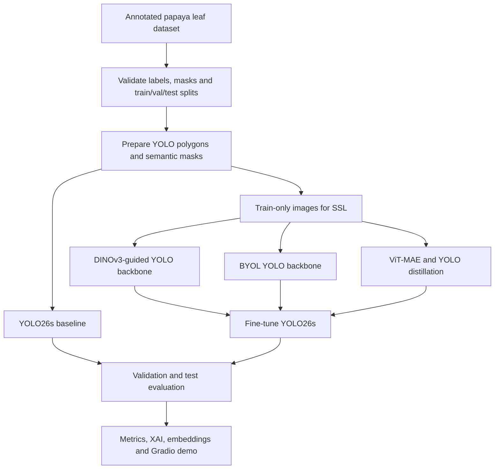

# YOLO26s: Self-Supervised Learning for Explainable Papaya Leaf Disease Segmentation

This directory documents the **YOLO26s segmentation experiments** conducted as part of the capstone project **Self-Supervised Representation Learning for Explainable Papaya Leaf Disease Segmentation**.

The study compares a YOLO26s baseline against three self-supervised learning (SSL) approaches—**DINOv3, BYOL, and MAE**—using the same annotated papaya leaf dataset and downstream segmentation task. It also examines segmentation quality, model efficiency, and explainability with **Grad-CAM** and **LIME**.

> **Scope:** This README describes the YOLO26s experiment only. DeepLabV3 and SegFormer have separate project materials.

## 1. Research objectives

- Prepare and validate annotated images, YOLO polygon labels, and semantic masks.
- Learn YOLO26s backbone representations using DINOv3-guided distillation, BYOL, and ViT-MAE-based pretraining/distillation.
- Fine-tune and compare four YOLO26s segmentation configurations.
- Evaluate both semantic-mask and native YOLO instance-segmentation metrics.
- Produce explainability visualizations, embedding analyses, and an interactive Gradio prototype.

## 2. Compared models

| ID | Configuration | Pretraining approach |
|---|---|---|
| `baseline` | YOLO26s | Baseline supervised segmentation training |
| `dino` | YOLO26s + DINOv3 | Frozen pretrained DINOv3 teacher guides the YOLO26s backbone by feature distillation |
| `byol` | YOLO26s + BYOL | Online/target-network self-supervised representation learning |
| `mae` | YOLO26s + MAE | ViT-MAE masked-image reconstruction followed by feature distillation to the YOLO26s backbone |

All four configurations use the YOLO26s segmentation architecture for downstream fine-tuning.

## 3. Dataset

The notebook uses an annotated papaya leaf dataset containing **1,358 samples**. The saved execution logs confirm the following split sizes:

| Split | Images |
|---|---:|
| Training | 944 |
| Validation | 207 |
| Testing | 207 |
| **Total** | **1,358** |

The six foreground categories are:

1. Healthy Leaf
2. Leaf Curl
3. Mealybug
4. Mite Disease
5. Mosaic
6. Ring Spot

For semantic-mask evaluation, **background** is included as a seventh class. The notebook checks the dataset manifests, required masks and polygons, and potential cross-split leakage using available source/group/hash identifiers.

**Dataset input:** The Kaggle notebook searches attached input datasets for a directory with `class_names.json`, `images/`, `masks/`, and `manifests/`, or for an `annotated.zip` archive. A previously prepared `yolo_ds` directory can also be reused. The dataset itself is **not embedded in the `.ipynb` file**.

## 4. Experiment settings

| Setting | Value |
|---|---|
| Backbone / segmentation architecture | YOLO26s (`yolo26s-seg.yaml`) |
| Number of foreground classes | 6 |
| Semantic classes including background | 7 |
| Input size for supervised fine-tuning | 640 |
| SSL crop size (notebook setup default) | 224 |
| SSL training epochs | 100 |
| Supervised fine-tuning epochs | 100 |
| Fine-tuning batch size (notebook setup default) | 16 |
| Random seed | 42 |
| Main execution platform | Kaggle notebook with GPU |

**Important:** Some batch sizes and setup paths in the uploaded notebook are marked `CHECK` by its author. Confirm these values against the intended training environment before rerunning.

## 5. Methodology



**Pipeline summary:**

1. **Data preparation:** Validate the 1,358-sample dataset; create compatible image, polygon-label and semantic-mask directories.
2. **SSL training:** Train the DINOv3-guided, BYOL, and MAE-derived YOLO26s backbone configurations using training images.
3. **Weight transfer:** Load the SSL backbone weights into the corresponding YOLO26s segmentation models.
4. **Downstream fine-tuning:** Fine-tune the baseline and three SSL variants for 100 epochs each.
5. **Model selection:** Select the deployment candidate using **validation mIoU**, without using test-set results for selection.
6. **Evaluation:** Compare semantic segmentation, native YOLO mask/box mAP, computational cost, and confidence intervals.
7. **Explainability:** Produce Grad-CAM, LIME, prediction overlays, and representation visualizations.
8. **Prototype:** Use the validation-selected model in a Gradio image-upload interface.

## 6. Reported test results

The following values are **from the saved output of the uploaded 100-epoch notebook**; they are not new runs.

| Model | mIoU (7 classes) | Mean Dice (7 classes) | Foreground precision | Foreground recall | Pixel accuracy | Mask mAP50 |
|---|---:|---:|---:|---:|---:|---:|
| YOLO26s baseline | 0.9510 | 0.9748 | 0.9666 | 0.9807 | 0.9781 | 0.9326 |
| YOLO26s + DINOv3 | **0.9528** | **0.9758** | 0.9664 | **0.9829** | **0.9791** | **0.9364** |
| YOLO26s + BYOL | 0.9421 | 0.9700 | 0.9622 | 0.9743 | 0.9759 | 0.9317 |
| YOLO26s + MAE | 0.9329 | 0.9649 | 0.9551 | 0.9696 | 0.9754 | 0.9336 |

### Interpretation

- **Highest observed test mIoU:** DINOv3 (0.9528), compared with baseline (0.9510).
- **Validation-selected model:** MAE, as recorded by the notebook's model-selection output.
- **Uncertainty matters:** A later 1,000-resample paired bootstrap analysis reported that the DINOv3–baseline mIoU difference had a 95% confidence interval including zero. Therefore, the observed numerical improvement should **not** be described as a statistically established improvement.
- The notebook also reports BYOL below the baseline on test mIoU, with the corresponding bootstrap difference interval below zero.

A validation-selected model and the model with the highest observed *test* score can differ; selection must be based on validation data to avoid test-set leakage.

## 7. Evaluation and visualizations

The experiment includes:

- Per-class IoU, Dice, precision, recall, and F1-score
- Overall mIoU, pixel accuracy, Macro-F1, and Matthews correlation coefficient (MCC)
- Native YOLO bounding-box and mask mAP
- Confusion matrices and model-by-model learning curves
- Bootstrap confidence intervals and paired baseline comparisons
- ROC-AUC and precision–recall AUC analyses
- Inference latency, model size, estimated operations, and parameter counts
- Grad-CAM and LIME explanation images
- Feature embedding analysis, PCA, K-means, and frozen-feature k-NN probes
- Example segmentation overlays and a Gradio prototype

**Note:** The `.ipynb` version prepared for GitHub may have its saved cell outputs removed to meet the browser-upload size limit. See the original Kaggle notebook and exported results to inspect the execution outputs.

## 8. Notebooks and experiment outputs

Main Kaggle notebook:

[Capstone Final YOLO26 — 100-Epoch Run](https://www.kaggle.com/code/sabikhossen/capstone-final-yolov26-run-for-100ephocs-final)

The notebook creates output files under paths resembling:

```text
/kaggle/working/
├── yolo_ds/
│   ├── images/
│   ├── labels/
│   ├── masks/
│   ├── data.yaml
│   ├── class_map.json
│   └── split_table.csv
└── papaya_real_dinov3_mae_e100/
    ├── checkpoints/
    │   ├── dino/ssl_weights.pt
    │   ├── byol/ssl_weights.pt
    │   └── mae/ssl_weights.pt
    ├── logs/
    ├── runs/
    │   ├── baseline_real_ssl_e100/
    │   ├── dino_real_ssl_e100/
    │   ├── byol_real_ssl_e100/
    │   └── mae_real_ssl_e100/
    └── eval/
        ├── figures/
        ├── val_summary.csv
        ├── test_summary.csv
        ├── test_metrics.json
        ├── test_bootstrap_1000.csv
        ├── ssl_health_checks.csv
        └── final_results_complete.csv
```

Each fine-tuning run is expected to have its own saved `weights/best.pt` and `weights/last.pt`. These **are generated artifacts**, not weights automatically contained in the notebook.

The notebook also creates a results backup named:

```text
papaya_yolo26_real_dinov3_mae_e100_results.zip
```

## 9. Running the notebook

1. Open the Kaggle notebook linked above, or upload the `.ipynb` file to Kaggle.
2. Enable a suitable GPU accelerator and attach the annotated dataset.
3. Verify the input files, dataset layout, class mapping, and configuration values.
4. Install the Python dependencies using the notebook's first cell.
5. Configure Hugging Face access if the DINOv3 model requires authentication.
6. Run the notebook cells in their intended order: setup → data preparation → SSL pretraining → fine-tuning → validation/test evaluation → visualizations and optional Gradio demo.
7. Download the generated results and checkpoints from Kaggle output storage.

### Core dependencies

The notebook installs or imports PyTorch, Ultralytics, Transformers, Hugging Face Hub, NumPy, pandas, OpenCV, Pillow, scikit-image, scikit-learn, Matplotlib, LIME, and Gradio. Its installation cell pins `ultralytics==8.4.182` and `lime==0.2.0.1`, along with compatible ranges for several other packages.

**Reproducibility note:** Reproducing a run requires the same dataset, training configuration, model sources, package compatibility, and accessible checkpoints. Results can differ across hardware and dependency versions. The temporary Gradio sharing URL generated by Kaggle is not a permanent deployment.

## 10. Files and storage

For the project-wide GitHub repository, the suggested destinations are:

| Artifact | Repository directory |
|---|---|
| Notebook and this README | `01_Notebooks/YOLO26/` |
| YOLO26 report | `02_Reports/` |
| Pipeline diagrams | `03_Diagrams/` |
| Architecture figures/configurations | `04_Model_Architectures/YOLO26/` |
| Dataset and segmentation annotations | `05_Datasets/` |
| `ssl_weights.pt` and `best.pt` checkpoints | `06_Saved_Models/` |
| Metrics CSV/JSON, plots and explainability results | `07_Results/YOLO26/` |
| Reusable scripts | `08_Source_Code/` |

Large datasets and model weights may require **Git LFS** or a separately linked artifact archive. Do not assume that uploading the notebook uploads any datasets or trained weights.

## 11. Project status

The saved notebook records completion of the four 100-epoch fine-tuning runs, model evaluation, and a results backup. Some final artifacts may still need to be transferred from Kaggle into the GitHub repository.

---

*Capstone research: Self-Supervised Representation Learning for Explainable Papaya Leaf Disease Segmentation.*
